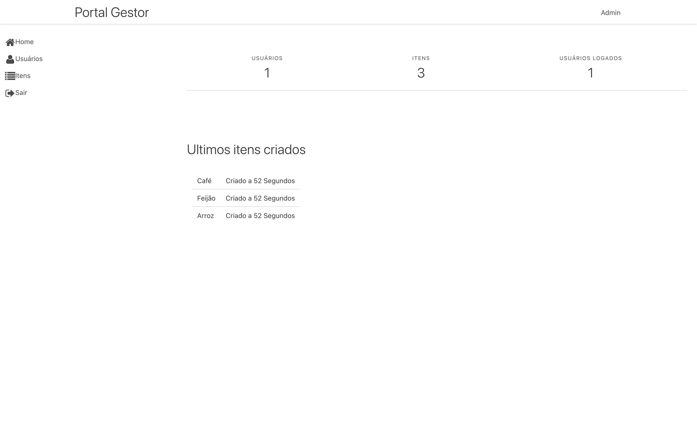
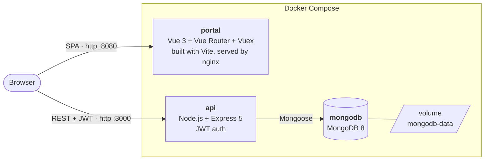

# MEVN Dockerized

A dockerized MEVN stack: **M**ongoDB, **E**xpress, **V**ue and **N**ode.js.



| Service   | Stack                                    | Port |
| --------- | ---------------------------------------- | ---- |
| `api`     | Node.js 24, Express 5, Mongoose 9        | 3000 (internal API; do not publish directly) |
| `portal`  | Vue 3 + Vite, served by nginx            | 8080 |
| `mongodb` | MongoDB 8 (data persisted in a volume)   | —    |

## Architecture



The portal serves the SPA and forwards `/api/` to the API on the Compose network.
The browser authenticates with a JWT stored after sign-in. For public access,
publish only the portal behind HTTPS; keep the API and MongoDB private.

## Quick start

1. Create the API environment file:

   ```sh
   cp api/.env.example api/.env
   # edit api/.env and set a real SECRET
   ```

2. Build and run everything:

   ```sh
   docker compose up --build
   ```

3. Open the apps:

   - Portal: <http://localhost:8080>
   - API: <http://localhost:3000>

4. Before exposing the app, create the first admin **from inside the API container**
   with a unique password of at least 16 characters. On the Docker host, enter
   it interactively (never put the password in a shell command or commit it):

   ```sh
   read -r -p 'Admin email: ' ADMIN_EMAIL
   read -r -s -p 'Admin password (16+ characters): ' ADMIN_PASSWORD; printf '\n'
   export ADMIN_EMAIL ADMIN_PASSWORD
   docker compose exec -e ADMIN_EMAIL -e ADMIN_PASSWORD api npm run bootstrap-admin
   unset ADMIN_EMAIL ADMIN_PASSWORD
   ```

   This command works only while the user collection is empty. There is no public
   bootstrap route or default admin password. Public registration creates only
   non-admin accounts; an admin can grant admin rights using the user edit page.
   JWTs expire after eight hours, so sign in again when one expires.

## API

The API is documented with **OpenAPI 3.1** in [`api/openapi.yaml`](api/openapi.yaml) —
paste it into the [Swagger Editor](https://editor.swagger.io) or point any
OpenAPI tooling at it. Summary:

| Method   | Path              | Auth | Description                          |
| -------- | ----------------- | ---- | ------------------------------------ |
| `GET`    | `/`               | —    | Health check                         |
| `POST`   | `/users/auth`     | —    | Authenticate and retrieve a JWT      |
| `POST`   | `/users/register` | —    | Register a new user                  |
| `GET`    | `/users/list`     | JWT  | List users                           |
| `GET`    | `/users/{id}`     | JWT  | Get a user by id                     |
| `PUT`    | `/users/{id}`     | JWT  | Update a user                        |
| `DELETE` | `/users/{id}`     | JWT  | Delete a user                        |
| `GET`    | `/items/list`     | JWT  | List items                           |
| `POST`   | `/items/register` | JWT  | Create an item                       |
| `PUT`    | `/items/{id}`     | JWT  | Update an item                       |
| `DELETE` | `/items/{id}`     | JWT  | Delete an item                       |
| `GET`    | `/info`           | JWT  | Dashboard statistics                 |

## Local development

### API

```sh
cd api
npm install

# needs a MongoDB running and the env vars from api/.env.example
SECRET=dev-secret DB_URI=mongodb://localhost:27017/mevn npm run dev
```

`npm run dev` uses Node's built-in watch mode, so the server restarts on file changes.
The API permits CORS only from `http://localhost:8080` by default (override with
`CORS_ORIGIN` for a different local dev origin). The Vite dev server proxies
`/api/` to `http://localhost:3000/` for the normal same-origin workflow.

### Portal

```sh
cd portal
npm install

npm run dev      # dev server with HMR at http://localhost:8080
npm run build    # production build to dist/
npm run preview  # serve the production build locally
npm run lint     # ESLint
```

The portal reads the API base URL from `VITE_API_URL` (defaults to `/api/`).
